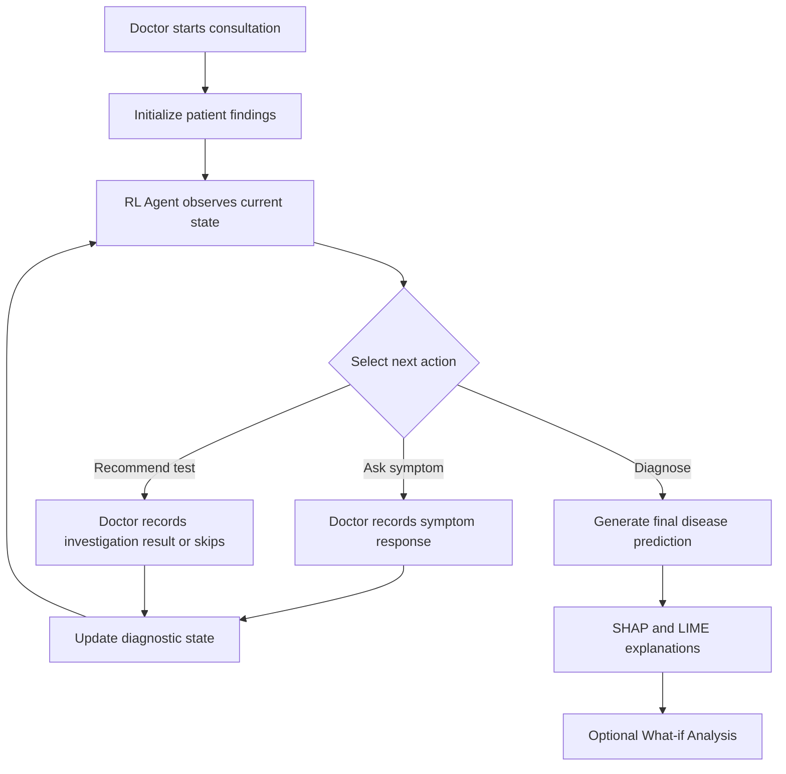

# 🩺 DiagnoPath AI — Reinforcement Learning-Based Clinical Decision Support

<p align="center">
  <b>An Explainable and Cost-Aware Clinical Decision Support Prototype</b>
  <br>
  Powered by Custom Linear Q-Learning and Explainable AI
</p>

---

## 🌟 Overview

DiagnoPath AI is an academic project that explores the application of **Reinforcement Learning (RL)** in clinical decision support.

Unlike conventional systems that generate predictions from a fixed set of symptoms, DiagnoPath models a clinical consultation as a sequence of intelligent decisions.

Using a custom **Linear Q-Learning agent**, the system dynamically determines whether to:

- Ask the doctor about additional patient symptoms.
- Recommend relevant medical investigations.
- Generate a final disease prediction based on the collected findings.

The system also incorporates Explainable AI techniques to make the agent's decisions more interpretable and introduces cost-aware diagnostic decision-making to explore ways of reducing unnecessary investigations.

---

## ✨ Key Features

| Feature | Description |
|---|---|
| 🤖 Reinforcement Learning | Custom Linear Q-Learning agent for sequential diagnostic decisions. |
| 🩺 Symptom Inquiry | Dynamically selects symptoms for the doctor to ask about. |
| 🔬 Investigation Recommendation | Suggests diagnostic investigations based on the current patient state. |
| 🔄 Sequential Decision-Making | Updates the diagnostic state as new findings are recorded. |
| ⏭️ Investigation Skipping | Allows investigations to be skipped without incorrectly treating them as negative. |
| 🎯 Disease Prediction | Generates a final prediction after the diagnostic sequence. |
| 🔍 Explainable AI | Integrates SHAP and LIME to explain feature contributions to the selected action's Q-score. |
| 🧪 What-if Analysis | Explores hypothetical changes to patient findings without modifying the original consultation. |
| 💰 Cost-Aware Decisions | Incorporates diagnostic action costs into the decision-support framework. |

---

## 🧠 System Workflow

DiagnoPath treats clinical diagnosis as a sequential decision-making problem.



### Consultation Process

1. Sign in to the application.
2. Select **Start RL Consultation** from the dashboard.
3. Enter an optional patient reference.
4. The RL agent observes the current diagnostic state.
5. The agent selects the next symptom inquiry or investigation.
6. The doctor records the actual symptom response or investigation result.
7. The diagnostic environment updates the patient state.
8. The agent continues selecting actions until a final prediction is generated.
9. SHAP and LIME explanations are displayed where the required packages are available.
10. What-if Analysis can be used to explore hypothetical patient findings.

---

## 🤖 Reinforcement Learning Model

The core decision-making component is a custom **Linear Q-Learning agent**.

The agent evaluates available diagnostic actions using the current state representation and their estimated Q-values.

### Available Actions

| Action | Purpose |
|---|---|
| Ask Symptom | Request information about a patient symptom. |
| Order Investigation | Recommend a diagnostic investigation. |
| Diagnose | Complete the diagnostic sequence and generate a prediction. |

### Model File

The application loads the experimental RL model from:

```text
models/diagnostic_linear_q_warmstart_experiment.json
```

### Model Evaluation

The evaluation script can be executed using:

```powershell
python -m rl.evaluate_experiment
```

**Experimental evaluation result:**

| Metric | Result |
|---|---:|
| Correct Diagnoses | 34 |
| Held-out Test Cases | 42 |
| Evaluation Accuracy | 81.0% |

The reported result is based on the repository's fixed held-out dataset split. It represents an experimental dataset evaluation, not clinical validation or guaranteed accuracy on unseen real-world patients.

---

## 🔍 Explainable Artificial Intelligence

DiagnoPath incorporates explainability techniques to help inspect the diagnostic decisions made by the RL agent.

### SHAP — SHapley Additive exPlanations

SHAP helps examine feature contributions associated with the selected RL action's Q-score.

### LIME — Local Interpretable Model-Agnostic Explanations

LIME provides a local explanation of the selected action by examining feature contributions.

The application also displays feature contributions from the Linear Q-Learning model.

These explanations improve transparency when inspecting model behaviour. They do not establish causal medical relationships.

---

## 🧬 Clinical Feature Representation

The current trained RL model uses categorical representations for clinical findings.

| Value | Meaning |
|---:|---|
| -1 | Unknown |
| 0 | Absent / Negative |
| 1 | Present / Positive |

The current model vocabulary does not define numerical laboratory thresholds.

Therefore, raw numerical laboratory values should not be interpreted as supported model inputs. Integrating numerical laboratory measurements would require documented thresholds, compatible preprocessing and appropriate model training.

---

## 🛠️ Technology Stack

| Component | Technology |
|---|---|
| Programming Language | Python |
| Backend Framework | FastAPI |
| Reinforcement Learning | Custom Linear Q-Learning |
| Explainable AI | SHAP, LIME |
| Database | SQLite / configured application database |
| Testing Framework | Pytest |
| Development Environment | Visual Studio Code |
| Version Control | Git and GitHub |

---

## 🚀 Installation and Setup

### Prerequisites

- Python 3.11
- Git
- Windows 10 / Windows 11

### 1. Clone the Repository

```powershell
git clone https://github.com/Varshakh8/DiagnoPath.git
```

### 2. Navigate to the Project Directory

```powershell
cd DiagnoPath
```

### 3. Create a Virtual Environment

```powershell
python -m venv venv
```

### 4. Activate the Virtual Environment

```powershell
.\venv\Scripts\Activate.ps1
```

### 5. Install Dependencies

```powershell
python -m pip install -r requirements.txt
```

### 6. Run the Application

```powershell
python run_app.py
```

### 7. Open in Browser

Visit:

**http://127.0.0.1:8000**

---

## 🔐 Demo Credentials

The application includes demonstration accounts for local testing.

| Username | Password |
|---|---|
| `doctor` | `clinic123` |
| `dr.mehta` | `clinic123` |

> These credentials are intended only for local demonstration and should not be used in a production deployment.

---

## 🧪 Testing and Code Coverage

The project includes automated tests covering important application components:

- Clinical API functionality
- Database and authentication logic
- Diagnostic environment
- Reinforcement Learning agent
- RL explainability components
- Live consultation module

### Run Tests

```powershell
python -m pytest -v
```

### Run Tests with Coverage

```powershell
python -m pytest --cov=app --cov=env --cov=rl --cov-report=term-missing
```

### Current Test Results

| Metric | Result |
|---|---:|
| Tests Passed | 129 |
| Overall Code Coverage | 56% |

Code coverage represents the measured execution of selected source modules. It is not a measure of diagnostic accuracy or clinical reliability.

---

## 📁 Project Documentation

For further implementation and validation details, refer to:

- `IMPLEMENTATION_NOTES.md`
- `requirements.txt`

---

## ⚠️ Limitations and Responsible Use

DiagnoPath AI is an academic research and development prototype for exploring Reinforcement Learning in clinical decision support.

- Predictions are experimental outputs and are not confirmed medical diagnoses.
- The system has not been clinically validated and must not replace qualified medical professionals.
- SHAP and LIME contributions explain model behaviour and should not be interpreted as causal medical claims.
- Relative disease scores displayed by the interface are not calibrated probabilities.
- The current model supports categorical findings and does not automatically interpret arbitrary numerical laboratory measurements.
- Evaluation results on the included dataset do not guarantee performance on new or real-world patients.

---

## 🔮 Future Enhancements

Potential directions for further development include:

- Integration and validation with larger and more diverse clinical datasets.
- Improved generalization to previously unseen patients.
- Support for numerical laboratory measurements with documented preprocessing.
- Further evaluation of diagnostic policies and decision costs.
- Expanded explainability and clinical workflow evaluation.
- Additional security and deployment improvements.

---

## 👥 Project Information

**Project Name:** DiagnoPath AI

**Project Domain:** Healthcare Artificial Intelligence and Reinforcement Learning

**Project Focus:** Explainable and cost-aware clinical decision support.

**GitHub Repository:** [Varshakh8/DiagnoPath](https://github.com/Varshakh8/DiagnoPath)

---

<p align="center">
  <b>DiagnoPath AI</b>
  <br>
  Exploring intelligent, explainable and cost-aware clinical decision support through Reinforcement Learning.
</p>